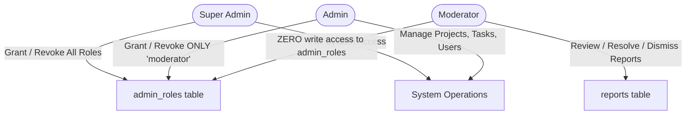

# SkillSwap AI — Phase 10: Second Security Audit & Hardening Report (V2)

**Date:** November 2, 2026  
**Project:** SkillSwap AI  
**Deployment Target:** Supabase PostgreSQL (`https://dylunnfzciikfsgdtobi.supabase.co`)  
**Scope:** Second security audit and revision of consolidated database schemas and storage policies.  
**Files Produced:**  
1. `supabase/migrations/20261102_consolidated_production_schema_v2.sql` (Master Schema Part 1)  
2. `supabase/migrations/20261102_team_room_and_storage_schema_v2.sql` (Team Room, Storage & Realtime Part 2)  

---

## Executive Summary

Following the initial Phase 10 review, a second in-depth security and architectural audit was performed to address 8 specific vulnerability vectors:
1. **RBAC Privilege Escalation:** Moderators were previously able to pass `is_admin` checks, potentially permitting self-promotion or administrative actions.
2. **Collaboration Request Mutation:** Participants could theoretically modify immutable fields (`sender_id`, `receiver_id`, `project_id`, `pitch_message`) or execute invalid lifecycle transitions (`cancelled -> accepted`).
3. **Session Manipulation:** Session participant IDs and agreed learning skills lacked database-enforced immutability on updates, and terminal sessions (`completed`, `cancelled`) were not protected against resurrection.
4. **Message Tampering:** While only recipients could update messages, the database did not explicitly protect `content`, `sender_id`, or `receiver_id` against unauthorized mutation during update operations.
5. **Notification Fabrication & Spoofing:** Previous policies allowed users to insert arbitrary notifications or lacked protections preventing malicious users from altering notification text.
6. **Unearned Review Exploitation:** Reviews with `session_id` did not enforce that the session had reached `completed` status, allowing reviews for cancelled or unheld sessions.
7. **Existing Database Upgrades & Index Collisions:** Pre-existing duplicate rows in `reviews` or `profile_skills` would cause unique index creation to fail on existing databases.
8. **Storage Asset Vandalism:** Disgruntled collaborators could delete team assets, and the distinction between public project discovery assets and private team room assets was ambiguous.

To resolve these without altering original files or executing live SQL, two hardened migration files (`_v2.sql`) were authored with defense-in-depth mechanisms: **PostgreSQL `BEFORE UPDATE` validation triggers**, **fine-grained RLS policies**, **pre-flight deduplication blocks**, and **explicit RBAC function hierarchies**.

---

## 1. Verified Inventory of Revised Migration Files

All files were generated in `supabase/migrations/` and verified intact. Original files were preserved unchanged.

| File Name | Exact File Path | Bytes | Lines | SHA-256 Checksum |
| :--- | :--- | :--- | :--- | :--- |
| **`20261102_consolidated_production_schema_v2.sql`** | `supabase/migrations/20261102_consolidated_production_schema_v2.sql` | 47,781 | 1,085 | `3D073DCCBA73B3C290FD88003A9F98901F5244ACF3359106E039ECD8A3D7FE62` |
| **`20261102_team_room_and_storage_schema_v2.sql`** | `supabase/migrations/20261102_team_room_and_storage_schema_v2.sql` | 15,760 | 361 | `6012E30DD8E587E475829CDF427375613A5FA7B1A05544FA6EC0F26E071BB5E2` |

---

## 2. Granular Security Audit & Implemented Fixes

### 2.1 RBAC Separation & Privilege Escalation Prevention



#### Vulnerabilities Identified in V1:
- `is_admin(uid)` returned `true` for any row in `public.admin_roles`, including `moderator`.
- `admin_roles_manage_policy` allowed anyone satisfying `is_admin` to insert or update any role. A moderator could execute an insert promoting themselves to `super_admin`.
- Normal users checking their own role via `checkUserAdminRole` were blocked from reading `admin_roles` unless they were already an admin.

#### Hardening Implemented in V2:
1. **Separated Role Functions:**
   - `public.get_user_role(uid)`: Returns user's assigned role (`'super_admin'`, `'admin'`, `'moderator'`, or `NULL`).
   - `public.is_super_admin(uid)`: Returns `true` strictly for `role = 'super_admin'`.
   - `public.is_admin_or_super(uid)`: Returns `true` strictly for `role in ('admin', 'super_admin')`.
   - `public.is_moderator_or_higher(uid)`: Returns `true` for `role in ('moderator', 'admin', 'super_admin')`.
   - `public.is_admin(uid)`: Backwards-compatible alias checking `public.is_admin_or_super(uid)`. Moderators are excluded.
2. **Granular RLS Policies on `public.admin_roles`:**
   - **`SELECT`:** `auth.uid() = user_id OR public.is_admin_or_super(auth.uid())`. Users can inspect their own role; admins can view all. Moderators cannot view other administrators.
   - **`INSERT`:** Only `super_admin` can grant `super_admin` or `admin`. An `admin` can *only* grant `moderator`. Moderators have zero insert rights.
   - **`UPDATE`:** Strictly restricted to `public.is_super_admin(auth.uid())`.
   - **`DELETE`:** Only `super_admin` can revoke admin roles. Admins can only revoke `moderator`. Moderators have zero delete rights.
3. **Moderation Separation (`public.reports`):**
   - Moderators, admins, and super admins can view and update report status (`reviewed`, `resolved`, `dismissed`).
   - Only admins and super admins can permanently delete reports.

---

### 2.2 Collaboration Requests: State Machine & Field Immutability

#### Vulnerabilities Identified in V1:
- An update operation could modify `sender_id`, `receiver_id`, or `project_id`, hijacking the proposal.
- A request in terminal state `declined` or `cancelled` could be re-opened or transitioned to `accepted`.
- RLS `WITH CHECK` alone cannot compare `OLD` and `NEW` records in PostgreSQL.

#### Hardening Implemented in V2:
1. **`BEFORE UPDATE` Validation Trigger (`validate_collaboration_request_update`):**
   - **Field Immutability Check:** Throws an exception if `id`, `sender_id`, `receiver_id`, `project_id`, `request_type`, `pitch_message`, `synergy_score`, or `created_at` are altered.
   - **State Transition Machine:**
     - `pending -> accepted | declined | cancelled` (Permitted).
     - `accepted -> cancelled` (Permitted for mutual cancellation).
     - `declined -> *` (Forbidden — terminal state).
     - `cancelled -> *` (Forbidden — terminal state).
   - **Automatic Timestamping:** Automatically sets `NEW.updated_at = timezone('utc'::text, now())`.
2. **Hardened RLS Policies:**
   - `collab_requests_insert_policy`: Enforces `auth.uid() = sender_id AND status = 'pending'`. A user cannot insert a request that is pre-marked as `accepted`.
   - `collab_requests_update_policy`: Strictly limits status transitions to authorized actors:
     - Receiver or Project Lead can set `status in ('accepted', 'declined')`.
     - Sender or accepted participant can set `status = 'cancelled'`.

---

### 2.3 Sessions: Participant Protection & Lifecycle Integrity

#### Vulnerabilities Identified in V1:
- Participant IDs (`creator_id`, `partner_id`) or agreed skills (`skill_to_learn`, `skill_to_teach`) could be updated post-booking.
- Completed or cancelled sessions could be reverted back to `scheduled`.

#### Hardening Implemented in V2:
1. **`BEFORE UPDATE` Validation Trigger (`validate_session_update`):**
   - **Field Immutability Check:** Protects `id`, `creator_id`, `partner_id`, `skill_to_learn`, `skill_to_teach`, and `created_at`.
   - **State Machine Transitions:**
     - `scheduled -> rescheduled | completed | cancelled` (Permitted).
     - `rescheduled -> rescheduled | completed | cancelled` (Permitted).
     - `completed -> *` (Forbidden — terminal state).
     - `cancelled -> *` (Forbidden — terminal state).
   - **Automatic Timestamping:** Automatically sets `NEW.updated_at = timezone('utc'::text, now())`.
2. **Hardened RLS Policies:**
   - `sessions_insert_policy`: Enforces `creator_id != partner_id AND status = 'scheduled'`.
   - `sessions_update_policy`: Restricted strictly to session participants or admins.

---

### 2.4 Messages: Read-Receipts Only & Content Immutability

#### Vulnerabilities Identified in V1:
- A recipient updating `read = true` could theoretically modify the message `content`, `sender_id`, or `created_at`.

#### Hardening Implemented in V2:
1. **`BEFORE UPDATE` Validation Trigger (`validate_message_update`):**
   - Protects `id`, `sender_id`, `receiver_id`, `content`, and `created_at`.
   - Throws exception if any column other than `read` is altered.
2. **Hardened RLS Policies:**
   - `messages_insert_policy`: Enforces `auth.uid() = sender_id AND sender_id != receiver_id AND read = false`.
   - `messages_update_policy`: Restricted strictly to `auth.uid() = receiver_id`.

---

### 2.5 Notifications: Anti-Spoofing & Content Protection

#### Vulnerabilities Identified in V1:
- Previous `notifications_owner_policy` checked `auth.uid() = user_id`, which blocked legitimate client notification creation (e.g. Alice sending Bob a message notification) OR, if opened up, allowed arbitrary spoofing.
- Users could alter the text or type of existing notifications.

#### Hardening Implemented in V2:
1. **Anti-Spoofing RLS Insert Policy (`notifications_insert_policy`):**
   - An authenticated user can ONLY insert a notification for another user if a verified, reciprocal interaction exists:
     - `type = 'new_message'`: Senders must have an actual message row sent to `user_id`.
     - `type in ('request_received', 'request_accepted', 'request_declined')`: Senders must have a collaboration request involving `user_id`.
     - `type in ('session_scheduled', 'session_reminder')`: Senders must have a session involving `user_id`.
     - `type = 'review_received'`: Senders must have submitted a review for `user_id`.
     - Admins can insert system notifications.
2. **`BEFORE UPDATE` Validation Trigger (`validate_notification_update`):**
   - Protects `id`, `user_id`, `type`, `title`, `message`, `link_tab`, and `created_at`.
   - Only `read` can be modified.
3. **Owner Management Policies:**
   - `notifications_select_policy`: Only the recipient or admin can read notifications.
   - `notifications_delete_policy`: Only the recipient or admin can delete/dismiss notifications.

---

### 2.6 Reviews: Completed Session Requirement & Eligibility Logic

#### Vulnerabilities Identified in V1:
- In `reviews_insert_policy`, the condition `(s.id = reviews.session_id or reviews.session_id is null)` allowed reviews for uncompleted or cancelled sessions.
- In general reviews (`session_id IS NULL`), any scheduled session was treated as qualification, even if never held.

#### Hardening Implemented in V2:
1. **Enforced Completed Sessions (`reviews_insert_policy`):**
   - **Case 1 (Session Review — `session_id IS NOT NULL`):**
     Requires an exact matching session between reviewer and target with `s.status = 'completed'`.
   - **Case 2 (General Review — `session_id IS NULL`):**
     Requires either an `accepted` collaboration request OR a session with `s.status = 'completed'`.
2. **Immutability Trigger (`prevent_review_update`):**
   - Peer reviews cannot be modified once published.
3. **Pre-Flight Deduplication & Partial Unique Indexes:**
   - Pre-flight SQL blocks remove existing duplicate records prior to index creation, guaranteeing zero migration failure.
   - `idx_reviews_unique_session` on `(reviewer_id, session_id) WHERE session_id IS NOT NULL`.
   - `idx_reviews_unique_general` on `(reviewer_id, target_id) WHERE session_id IS NULL`.

---

### 2.7 Existing Database Compatibility & Safe Upgrades

1. **Safe Column Additions:**
   All tables utilize `ALTER TABLE ... ADD COLUMN IF NOT EXISTS` for all supplemental fields across `profiles`, `projects`, `collaboration_requests`, `sessions`, `messages`, `notifications`, `reports`, and `project_tasks`.
2. **Dynamic Check Constraint Replacements:**
   PL/pgSQL dynamic blocks safely check for existing check constraints before dropping and replacing:
   - `profile_skills_category_check` (all 12 categories).
   - `collaboration_requests_status_check` (`'pending'`, `'accepted'`, `'declined'`, `'cancelled'`).
3. **Legacy Policy Clean-Up:**
   Every core table includes an explicit drop inventory covering all legacy policy names (e.g., `"Allow public read access to all profiles"`, `"Allow users to insert their own profile"`, V1 policies).

---

### 2.8 Storage: Public Discovery vs. Private Team Assets

#### Vulnerabilities Identified in V1:
- Storage assets in `project-assets` could be deleted by any team contributor.
- Access controls did not differentiate between public showcase assets and internal team documents.

#### Hardening Implemented in V2:
1. **Public vs. Private Access (`project_assets_select_policy`):**
   - Public marketplace projects (`status IN ('recruiting', 'in_progress', 'completed')`) allow public read access for screenshots and assets.
   - Non-public / draft projects or internal assets are restricted strictly to confirmed project contributors (`is_project_contributor`) or admins.
2. **Uploads (`project_assets_insert_policy`):**
   - Strictly restricted to authenticated users verified as project contributors (`public.is_project_contributor`).
3. **Anti-Vandalism Deletion Policy (`project_assets_delete_policy`):**
   - Deletion of project assets is restricted strictly to the **Project Creator** or an **Administrator**. Team contributors cannot delete project assets.
4. **Avatars Bucket (`avatars`):**
   - Path-isolated to `avatars/{userId}/{filename}`. Only the account owner can upload, update, or delete.

---

## 3. Unresolved Concerns & Environment Dependencies

While the SQL migrations are hardened and robust, the following environmental prerequisites must be observed:

1. **Initial Super Admin Bootstrap:**
   - The initial Super Admin account cannot be created via the web application or client API. It **must** be created by running the manual bootstrap query in the Supabase Dashboard SQL Editor after registering an account.
2. **Postgres Realtime Subscription Settings:**
   - The script enables `REPLICA IDENTITY FULL` on `project_tasks` and `project_messages`. Ensure the Supabase project has Realtime enabled under **Database** -> **Replication**.
3. **Supabase Storage Extension:**
   - Storage policies rely on `storage.foldername(name)`. This function is built into Supabase Storage. If running on a standalone local PostgreSQL instance without the Supabase Storage schema, storage policies must be omitted.

---

## 4. Sequential Deployment Guide (V2)

Execute these two files in order in the **Supabase Dashboard SQL Editor**:

1. **Step 1:** Paste and run [`supabase/migrations/20261102_consolidated_production_schema_v2.sql`](file:///C:/Users/asus/Downloads/New%20folder/supabase/migrations/20261102_consolidated_production_schema_v2.sql).
2. **Step 2:** Paste and run [`supabase/migrations/20261102_team_room_and_storage_schema_v2.sql`](file:///C:/Users/asus/Downloads/New%20folder/supabase/migrations/20261102_team_room_and_storage_schema_v2.sql).
3. **Step 3 (Bootstrap Super Admin):**
   ```sql
   INSERT INTO public.admin_roles (user_id, role)
   VALUES ('YOUR-USER-UUID-HERE', 'super_admin')
   ON CONFLICT (user_id) DO UPDATE SET role = 'super_admin';
   ```
4. **Step 4 (Verification Query):**
   ```sql
   SELECT 'Tables' AS category, COUNT(*) AS count 
   FROM information_schema.tables 
   WHERE table_schema = 'public' 
     AND table_name IN (
       'admin_roles', 'profiles', 'profile_skills', 'projects', 
       'project_roles', 'project_members', 'collaboration_requests', 
       'sessions', 'messages', 'notifications', 'reviews', 
       'reports', 'project_tasks', 'project_messages'
     )
   UNION ALL
   SELECT 'Views' AS category, COUNT(*) AS count 
   FROM information_schema.views 
   WHERE table_schema = 'public' AND table_name = 'public_profiles'
   UNION ALL
   SELECT 'Buckets' AS category, COUNT(*) AS count 
   FROM storage.buckets 
   WHERE id IN ('avatars', 'project-assets');
   ```
   *Expected output:* Tables: `14`, Views: `1`, Buckets: `2`.
