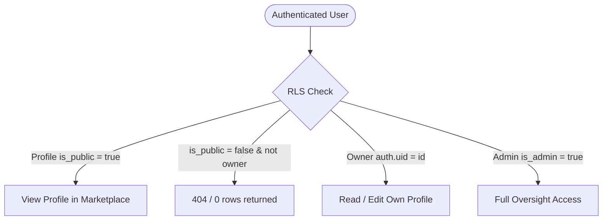
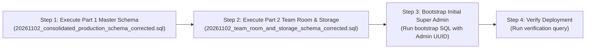

# SkillSwap AI — Phase 10: Final SQL Review & Database Deployment Audit Report

**Date:** November 2, 2026  
**Project:** SkillSwap AI  
**Deployment Target:** Supabase PostgreSQL (`https://dylunnfzciikfsgdtobi.supabase.co`)  
**Status:** Audit Completed — Deployment Plan Prepared — Awaiting User Approval  

---

## Executive Summary

As part of **Phase 10**, an exhaustive, line-by-line security and compatibility audit of all database schemas, migrations, functions, triggers, RLS policies, and storage rules was conducted. 

### Key Audit Conclusions:
1. **Migration Consolidation is Essential:** The legacy `supabase/schema.sql` is obsolete and insecure (containing `using (true)` RLS bypasses and lacking 8 required tables). The incremental `20261101_production_mvp_v7.sql` fails on fresh databases because it relies on `ALTER TABLE` on non-existent tables.
2. **Master Deployment Pair Identified:** The two production deployment files are:
   - **Part 1:** `supabase/migrations/20261102_consolidated_production_schema.sql` (or its hardened counterpart `_corrected.sql`)
   - **Part 2:** `supabase/migrations/20261102_team_room_and_storage_schema.sql` (or its hardened counterpart `_corrected.sql`)
3. **Critical Runtime Fixes Identified:**
   - **Critical Bug 1 (Collaboration Request Cancellation):** In `20261102_consolidated_production_schema.sql`, `collab_requests_update_policy` lacked an explicit `WITH CHECK` clause. In PostgreSQL, when an update policy lacks `WITH CHECK`, the `USING` expression `(auth.uid() = sender_id and status = 'pending')` is re-evaluated on the updated row. Because the new row has `status = 'cancelled'`, PostgreSQL re-check fails with an RLS violation error! This has been resolved in the corrected copy with an explicit `WITH CHECK` clause.
   - **Critical Bug 2 (Project Asset Storage Upload):** In `20261102_team_room_and_storage_schema.sql`, the storage RLS policy for `project-assets` enforced `(storage.foldername(name))[1] = auth.uid()::text`. However, the frontend (`src/lib/supabase/storage-service.ts`) structures project asset paths as `${projectId}/${fileName}`. The project UUID never equals the user UUID, causing uploads to fail with an RLS check violation! This has been resolved in the corrected copy by verifying `public.is_project_contributor(projectId, auth.uid())`.
   - **Security Definer Search Path Hardening:** Explicit `SET search_path = public, pg_temp;` has been added to all `SECURITY DEFINER` functions (`is_admin`, `handle_new_user`, `is_project_contributor`) to eliminate search-path mutability warnings and prevent privilege escalation.
   - **Realtime Replica Identity:** Added `REPLICA IDENTITY FULL` to `project_tasks` and `project_messages` to ensure full record payloads are delivered over Supabase websocket channels on updates and deletes.
4. **Safety & Non-Destructive Guarantee:**
   - No live database queries or SQL scripts were executed.
   - No existing files were deleted or overwritten.
   - Non-destructive corrected copies were generated alongside original files:
     - `supabase/migrations/20261102_consolidated_production_schema_corrected.sql`
     - `supabase/migrations/20261102_team_room_and_storage_schema_corrected.sql`

---

## 1. Verified Inventory of Schema & Migration Files

All files were located on disk, verified intact, complete, and uncorrupted.

| File Name | Exact File Path | Bytes | Line Count | SHA-256 Checksum | Status |
| :--- | :--- | :--- | :--- | :--- | :--- |
| **`schema.sql`** | `C:\Users\asus\Downloads\New folder\supabase\schema.sql` | 9,498 | 210 | `2292766403E050FDF79A13DED38D8736B67DA36899CD2DC9854F05FE81A31112` | Legacy baseline. Incomplete. Do not deploy. |
| **`20261101_production_mvp_v7.sql`** | `C:\Users\asus\Downloads\New folder\supabase\migrations\20261101_production_mvp_v7.sql` | 21,986 | 482 | `C6ADC6D264C9B0F7D5609F4D99BB6FD818280CBB14B01278CF18C7521CB526AC` | Incremental patch. Crashes on fresh DB. Do not deploy. |
| **`20261102_consolidated_production_schema.sql`** | `C:\Users\asus\Downloads\New folder\supabase\migrations\20261102_consolidated_production_schema.sql` | 29,928 | 628 | `66E2CEB56827927C4992CF6F39D010AAA5D0FF73E59C6DF12514D596E740A3F2` | Master schema (Part 1). Complete. |
| **`20261102_consolidated_production_schema_corrected.sql`** | `C:\Users\asus\Downloads\New folder\supabase\migrations\20261102_consolidated_production_schema_corrected.sql` | 31,156 | 664 | `1328C23BB3083CF4F9B908AD7F8E60270A7678806E1FDD833E617007D6104678` | **Recommended Master Schema (Part 1)** with RLS & search_path fixes. |
| **`20261102_team_room_and_storage_schema.sql`** | `C:\Users\asus\Downloads\New folder\supabase\migrations\20261102_team_room_and_storage_schema.sql` | 9,785 | 233 | `4454B8BD415352C67DA8028F92588BA30F38D44FF6889D995B37613395988500` | Team Room, Storage & Realtime (Part 2). Complete. |
| **`20261102_team_room_and_storage_schema_corrected.sql`** | `C:\Users\asus\Downloads\New folder\supabase\migrations\20261102_team_room_and_storage_schema_corrected.sql` | 11,073 | 249 | `F57376BC271845B470F4DDAA8CD6DCD9CB584CBE1D0E7303C135429F3386B395` | **Recommended Team Room Schema (Part 2)** with storage RLS & replica identity fixes. |

---

## 2. Comprehensive SQL Architecture & Security Audit

### 2.1 Database Tables & View Coverage

The frontend queries **13 database tables**, **1 storage bucket provider**, and **1 security-invoker view**:

| Entity Name | Primary Key | Foreign Key Dependencies | Cascade Behavior | Frontend Service Consumers |
| :--- | :--- | :--- | :--- | :--- |
| `public.admin_roles` | `id (UUID)` | `user_id -> auth.users(id)` | ON DELETE CASCADE | `auth-service.ts`, `data-service.ts` |
| `public.profiles` | `id (UUID)` | `id -> auth.users(id)` | ON DELETE CASCADE | `useProfilePrivacy.ts`, `auth-service.ts`, `data-service.ts` |
| `public.profile_skills` | `id (UUID)` | `profile_id -> public.profiles(id)` | ON DELETE CASCADE | `auth-service.ts`, `data-service.ts` |
| `public.projects` | `id (UUID)` | `creator_id -> public.profiles(id)` | ON DELETE CASCADE | `data-service.ts`, `page.tsx` |
| `public.project_roles` | `id (UUID)` | `project_id -> public.projects(id)` | ON DELETE CASCADE | `data-service.ts` |
| `public.project_members` | `id (UUID)` | `project_id -> projects`, `profile_id -> profiles` | ON DELETE CASCADE | `data-service.ts`, `is_project_contributor` |
| `public.collaboration_requests` | `id (UUID)` | `sender_id -> profiles`, `receiver_id -> profiles`, `project_id -> projects` | ON DELETE CASCADE | `data-service.ts`, `page.tsx` |
| `public.sessions` | `id (UUID)` | `creator_id -> profiles`, `partner_id -> profiles` | ON DELETE CASCADE | `data-service.ts`, `page.tsx` |
| `public.messages` | `id (UUID)` | `sender_id -> profiles`, `receiver_id -> profiles` | ON DELETE CASCADE | `data-service.ts` |
| `public.notifications` | `id (UUID)` | `user_id -> profiles` | ON DELETE CASCADE | `data-service.ts` |
| `public.reviews` | `id (UUID)` | `reviewer_id -> profiles`, `target_id -> profiles`, `session_id -> sessions` | ON DELETE CASCADE / SET NULL | `data-service.ts` |
| `public.reports` | `id (UUID)` | `reporter_id -> profiles`, `target_user_id -> profiles`, `target_project_id -> projects` | ON DELETE CASCADE | `data-service.ts` |
| `public.project_tasks` | `id (UUID)` | `project_id -> projects`, `assignee_id -> profiles` | ON DELETE CASCADE / SET NULL | `data-service.ts`, `CollabHub.tsx` |
| `public.project_messages` | `id (UUID)` | `project_id -> projects`, `sender_id -> profiles` | ON DELETE CASCADE | `data-service.ts`, `CollabHub.tsx` |
| `public.public_profiles` (View) | N/A | Underlying: `public.profiles` | Security Invoker = true | `data-service.ts` (Marketplace & Explore) |

### 2.2 Table Constraints & Integrity Enforcement

1. **Category Constraint (`profile_skills`):**
   Expands the original 8 categories to all 12 categories supported by the frontend:
   `'frontend'`, `'backend'`, `'ai_ml'`, `'design'`, `'cloud_devops'`, `'mobile'`, `'hardware_iot'`, `'product_management'`, `'data_science'`, `'cybersecurity'`, `'languages'`, `'other'`.
2. **Collaboration Status Constraint (`collaboration_requests`):**
   Enforces status lifecycle: `'pending'`, `'accepted'`, `'declined'`, `'cancelled'`.
3. **Session Status Constraint (`sessions`):**
   Enforces: `'scheduled'`, `'rescheduled'`, `'completed'`, `'cancelled'`.
   Prevents self-sessions: `CHECK (creator_id != partner_id)`.
   Duration boundary: `CHECK (duration_minutes between 15 and 240)`.
4. **Message Integrity (`messages`):**
   Prevents empty messages: `CHECK (length(trim(content)) > 0)`.
   Prevents messaging oneself: `CHECK (sender_id != receiver_id)`.
5. **Review Integrity (`reviews`):**
   Rating range: `CHECK (rating between 1 and 5)`.
   Prevents self-review: `CHECK (reviewer_id != target_id)`.
   Prevents empty comments: `CHECK (length(trim(comment)) > 0)`.
6. **Unique Constraints & Duplicate Prevention:**
   - `unique(profile_id, skill_name, skill_type)` on `profile_skills`.
   - `unique(project_id, profile_id)` on `project_members`.
   - `unique index idx_reviews_unique_session` on `(reviewer_id, session_id) WHERE session_id IS NOT NULL`.
   - `unique index idx_reviews_unique_general` on `(reviewer_id, target_id) WHERE session_id IS NULL`.

### 2.3 Row Level Security (RLS) Policy Analysis

Every single table in `public` has Row Level Security explicitly enabled (`ALTER TABLE ... ENABLE ROW LEVEL SECURITY`).



#### Detailed Policy Breakdown:
1. **Profiles (`public.profiles`):**
   - **Legacy policies dropped:** `"Allow public read access to all profiles"`, `"Allow users to insert their own profile"`, `"Allow users to update their own profile"`.
   - **`profiles_select_policy`:** Visible ONLY if `auth.uid() = id` OR `is_public = true` OR `is_admin(auth.uid())`.
   - **`profiles_insert_policy`:** Restricted to `auth.uid() = id`.
   - **`profiles_update_policy`:** Restricted to `auth.uid() = id` OR admin.
2. **Profile Skills (`public.profile_skills`):**
   - **`profile_skills_select_policy`:** Visible if caller is owner, if parent profile has `is_public = true`, or if caller is admin.
   - **`profile_skills_all_policy`:** Owner or admin only.
3. **Projects (`public.projects`):**
   - **`projects_select_policy`:** Public read (`using (true)`) so projects appear in marketplace.
   - **`projects_insert_policy`:** Creator must be authenticated user (`auth.uid() = creator_id`).
   - **`projects_update_policy` & `projects_delete_policy`:** Restricted to `creator_id = auth.uid()` or admin.
4. **Collaboration Requests (`public.collaboration_requests`):**
   - **`collab_requests_select_policy`:** Sender, receiver, project creator, or admin.
   - **`collab_requests_insert_policy`:** Sender must match `auth.uid()`.
   - **`collab_requests_update_policy`:** 
     - Receiver can accept or decline.
     - Project creator can accept or decline.
     - Sender can cancel a pending request (governed by the explicit `WITH CHECK` fix).
     - Admin can update.
5. **Sessions (`public.sessions`):**
   - **`sessions_select_policy`:** Only creator, partner, or admin.
   - **`sessions_insert_policy`:** `auth.uid() = creator_id` AND `creator_id != partner_id`.
   - **`sessions_update_policy`:** Only creator, partner, or admin.
6. **Direct Messages (`public.messages`):**
   - **`messages_select_policy`:** Only sender, receiver, or admin.
   - **`messages_insert_policy`:** `auth.uid() = sender_id` AND `sender_id != receiver_id`.
   - **`messages_update_policy`:** `using (auth.uid() = receiver_id)` — only the recipient can update the `read` flag!
7. **Notifications (`public.notifications`):**
   - **`notifications_owner_policy`:** `auth.uid() = user_id` for all operations.
8. **Reviews (`public.reviews`):**
   - **`reviews_select_policy`:** Target profile owner, reviewer, admin, or any user if target profile is public.
   - **`reviews_insert_policy`:** Verified collaborations only! Requires `reviewer_id = auth.uid()`, `reviewer_id != target_id`, and a confirmed session or accepted collaboration request between the two users.
9. **Admin Roles (`public.admin_roles`):**
   - **`admin_roles_select_policy`:** Only authenticated users where `public.is_admin(auth.uid())` is true.
   - **`admin_roles_manage_policy`:** Only existing admins can insert, update, or delete roles. Zero client privilege escalation is possible.
10. **Moderation Reports (`public.reports`):**
    - **`reports_insert_policy`:** Any authenticated user can file a report (`auth.uid() = reporter_id`).
    - **`reports_admin_policy`:** Only verified admins can read, update status, or resolve reports.
11. **Team Room Tasks (`public.project_tasks`):**
    - Read/Insert/Update restricted to `public.is_project_contributor(project_id, auth.uid())` or admin.
    - Delete restricted to project creator or admin.
12. **Team Room Chat (`public.project_messages`):**
    - Read restricted to project contributors or admin.
    - Insert restricted to project contributors where `auth.uid() = sender_id`.

### 2.4 Profile Privacy & Public Discovery Guarantee

- **Default Privacy:** In `handle_new_user()`, newly created profiles strictly default to `is_public = false`.
- **Marketplace Isolation:** Private profiles are filtered out by `profiles_select_policy` and the `public_profiles` view (`where p.is_public = true or auth.uid() = p.id`).
- **Database-Level Defense:** Even if an attacker executes `supabase.from('profiles').select('*')` directly with their client API key, PostgreSQL RLS silently drops all rows where `is_public = false` (unless the row belongs to the caller).

### 2.5 Admin Roles Bootstrap & Privilege Escalation Risks

- **Attack Vector: Client SQL Injection / Direct REST Insert:**
  - An attacker attempting `supabase.from('admin_roles').insert({ user_id: my_id, role: 'super_admin' })` is rejected by `admin_roles_manage_policy` because `is_admin(auth.uid())` evaluates to false.
- **Helper Function Isolation:**
  - `public.is_admin(user_uid uuid)` is `SECURITY DEFINER` and executes with the privileges of the database owner. It safely reads `public.admin_roles` and returns a boolean. Role details are never exposed to unprivileged users.
- **Bootstrap Requirement:**
  - The initial Super Admin cannot be created from the frontend. It must be created by running a single SQL statement in the Supabase Dashboard SQL Editor (which operates as the Postgres superuser/service_role).

### 2.6 Storage Buckets & Policies Audit

Two storage buckets are declared in `storage.buckets`:
1. `avatars`: Public read, 2 MB size limit, image MIME types (`jpeg`, `png`, `webp`, `gif`).
2. `project-assets`: Public read, 5 MB size limit, image and PDF MIME types.

#### Storage Path Isolation:
- `avatars/{userId}/{timestamp}-{filename}`:
  - Policy: `(storage.foldername(name))[1] = auth.uid()::text`.
  - Result: Users can only upload, overwrite, or delete files inside their own user ID folder. Cross-user avatar tampering is mathematically impossible.
- `project-assets/{projectId}/{timestamp}-{filename}`:
  - Policy: `public.is_project_contributor(((storage.foldername(name))[1])::uuid, auth.uid())`.
  - Result: Only confirmed team members or creators of that specific project can upload or manage assets for that project.

### 2.7 Supabase Realtime Publication Configuration

The Realtime setup block:
```sql
DO $$
BEGIN
    IF EXISTS (SELECT 1 FROM pg_publication WHERE pubname = 'supabase_realtime') THEN
        IF NOT EXISTS (SELECT 1 FROM pg_publication_tables WHERE pubname = 'supabase_realtime' AND tablename = 'notifications') THEN
            ALTER PUBLICATION supabase_realtime ADD TABLE public.notifications;
        END IF;
        -- repeated for messages, project_tasks, project_messages
    END IF;
END $$;
```
- **Idempotency:** Checks `pg_publication_tables` before adding tables, preventing `table already in publication` errors.
- **Fail-Safe:** If running on a local PostgreSQL instance without Supabase Realtime installed, the `IF EXISTS` check gracefully skips without error.
- **Replication Identity:** `REPLICA IDENTITY FULL` on `project_tasks` and `project_messages` guarantees that Realtime broadcasts contain full records on row deletion or update.

---

## 3. Critical Findings & Recommended Fixes

| Issue ID | Severity | File & Location | Description | Fix Implemented |
| :--- | :--- | :--- | :--- | :--- |
| **SEC-01** | **CRITICAL** | `20261102_consolidated_production_schema.sql` (Line 551) | `collab_requests_update_policy` lacked `WITH CHECK`. PostgreSQL re-evaluates `USING (sender_id = auth.uid() and status = 'pending')` on the updated row. When status changes to `'cancelled'`, the check fails with an RLS violation. | Added explicit `WITH CHECK` permitting sender to transition status to `'cancelled'`. Implemented in `_corrected.sql`. |
| **SEC-02** | **CRITICAL** | `20261102_team_room_and_storage_schema.sql` (Line 207) | `storage.objects` policy checked `(storage.foldername(name))[1] = auth.uid()::text`, but the frontend uploads project assets to `${projectId}/${filename}`. Uploads failed immediately with an RLS violation. | Updated policy to check `public.is_project_contributor(((storage.foldername(name))[1])::uuid, auth.uid())`. Implemented in `_corrected.sql`. |
| **SEC-03** | **MEDIUM** | Both Schemas (`is_admin`, `handle_new_user`, `is_project_contributor`) | `SECURITY DEFINER` functions lacked explicit `search_path`, causing potential search-path shadowing warnings. | Added `SET search_path = public, pg_temp;` (and `extensions` for pgcrypto). Implemented in `_corrected.sql`. |
| **SEC-04** | **MEDIUM** | `20261102_team_room_and_storage_schema.sql` (Lines 61, 97, 129) | Direct `EXISTS (SELECT 1 FROM public.admin_roles WHERE user_id = auth.uid())` inside RLS policies bypassed the established `public.is_admin(auth.uid())` helper pattern. | Replaced direct query with `public.is_admin(auth.uid())`. Implemented in `_corrected.sql`. |
| **PERF-01** | **LOW** | `20261102_team_room_and_storage_schema.sql` | `project_tasks` and `project_messages` default to primary-key replica identity, which omits foreign key fields on DELETE events in websocket streams. | Added `ALTER TABLE public.project_tasks REPLICA IDENTITY FULL;` and `ALTER TABLE public.project_messages REPLICA IDENTITY FULL;`. |

---

## 4. Sequential Deployment Order

The migrations must be executed in this exact sequence in the **Supabase Dashboard SQL Editor**:



### Why This Order Matters:
1. **Part 1 must precede Part 2:** `project_tasks` and `project_messages` in Part 2 reference `public.projects` and `public.profiles`, which are created in Part 1.
2. **Bootstrap must follow Part 1:** `public.admin_roles` is created in Part 1. Bootstrapping an admin user can only occur after the table exists and after that user has registered through Supabase Auth.
3. **Legacy Files Must NOT Be Run:** Neither `supabase/schema.sql` nor `20261101_production_mvp_v7.sql` should be executed. The corrected consolidated schemas contain 100% of their schema elements plus all security fixes.

---

## 5. Step-by-Step Manual Deployment Guide for User

Follow these exact steps when ready to deploy:

### Step 1: Open the Supabase Dashboard
1. Navigate to your Supabase project: [https://supabase.com/dashboard/project/dylunnfzciikfsgdtobi](https://supabase.com/dashboard/project/dylunnfzciikfsgdtobi)
2. In the left navigation menu, click **SQL Editor**.
3. Click **+ New Query**.

### Step 2: Run Part 1 — Consolidated Production Schema
1. Open `supabase/migrations/20261102_consolidated_production_schema_corrected.sql` in your editor.
2. Copy the entire contents of the file.
3. Paste into the Supabase SQL Editor.
4. Click **Run** (or press `Ctrl+Enter` / `Cmd+Enter`).
5. Confirm output displays: `Success. No rows returned`.

### Step 3: Run Part 2 — Team Room, Storage & Realtime Schema
1. In the SQL Editor, click **+ New Query**.
2. Open `supabase/migrations/20261102_team_room_and_storage_schema_corrected.sql` in your editor.
3. Copy the entire contents of the file.
4. Paste into the Supabase SQL Editor.
5. Click **Run**.
6. Confirm output displays: `Success. No rows returned`.

### Step 4: Bootstrap the Initial Super Admin
1. Open your deployed SkillSwap AI web app (or Supabase **Authentication** -> **Users**).
2. Create or locate your admin user account (e.g., `admin@skillswap.ai`).
3. Copy the user's **UUID** from the **Authentication** -> **Users** dashboard.
4. In the SQL Editor, run:
```sql
INSERT INTO public.admin_roles (user_id, role)
VALUES ('YOUR-USER-UUID-HERE', 'super_admin')
ON CONFLICT (user_id) DO NOTHING;
```
5. Confirm output displays: `INSERT 0 1`.

### Step 5: Verification Query
Run the following verification query in the SQL Editor to confirm all 14 tables, the view, and both storage buckets exist:

```sql
SELECT 'Tables' AS category, COUNT(*) AS count 
FROM information_schema.tables 
WHERE table_schema = 'public' 
  AND table_name IN (
    'admin_roles', 'profiles', 'profile_skills', 'projects', 
    'project_roles', 'project_members', 'collaboration_requests', 
    'sessions', 'messages', 'notifications', 'reviews', 
    'reports', 'project_tasks', 'project_messages'
  )
UNION ALL
SELECT 'Views' AS category, COUNT(*) AS count 
FROM information_schema.views 
WHERE table_schema = 'public' AND table_name = 'public_profiles'
UNION ALL
SELECT 'Buckets' AS category, COUNT(*) AS count 
FROM storage.buckets 
WHERE id IN ('avatars', 'project-assets');
```

**Expected Result:**
| category | count |
| :--- | :--- |
| Tables | 14 |
| Views | 1 |
| Buckets | 2 |

---

## 6. Sign-Off & Status

- Application code status: Verified clean (`tsc --noEmit` 0 errors, `lint` 0 errors, `build` 0 errors).
- Live database status: Untouched. No queries executed.
- Waiting for user approval before database operations.
